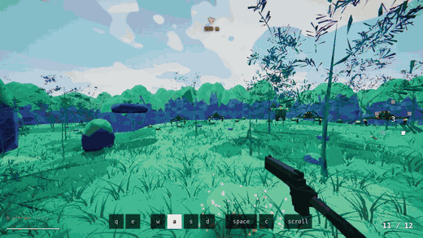

# phase

[](demo/demo.mp4)

*Phasing out of a swarm with E, then looping through all five dimensions, wall running boulders, and fighting with the pistol, bow and sword. [The full video](demo/demo.mp4) has sound.*

Phase is a first-person parkour shooter that runs in the browser. The scroll wheel, or Q and E, slides you between five dimensions that share one map but not the same landscape, enemies or colours. An enemy only exists in its own dimension, so a swarm that is about to catch you can be dodged by phasing out, and a short scroll lets you peek into the next dimension to see what waits there. The dimensions form a ring, so pressing E past the last one takes you back to the first.

## Play

**[rohanadwankar.github.io/phase](https://rohanadwankar.github.io/phase/)**. Add `?practice` for a practice mode where enemies crawl, nothing can hurt you, and a short list of things to try ticks over as you do them.

| | |
|---|---|
| Move | `W` `A` `S` `D`, mouse to look, `Space` to jump and again in the air to double jump, hop on landing to bunny hop |
| Slide and wall run | `C` slides, run into a boulder to climb it, hold right mouse to glide |
| Phase | `E` and `Q` or the scroll wheel; a short scroll only peeks |
| Weapons | `1` pistol (`R` reloads, `G` grenade), `2` bow (hold to draw, `G` plants TNT you shoot to blow up), `3` sword (tap to chop, hold and release to surge with a 360 cut, aimed where you look at full charge) |

## The run

Each shrine has five beacons, one in each dimension, and the arrow at the top of the screen points at the next one in its dimension's colour. Every beacon is guarded by its own boss (a stomper, a sniper, a summoner, a charger and a blinker) that must die before the crystal can be lit. Light all five in order and the warden wakes: it hunts you across dimensions, can hit you from any of them, and can only be hurt in the one it currently stands in. Every completed shrine makes every enemy tougher, kills heal you by the size of the enemy, and some drop powerups that stack for the rest of the run.

## Run it locally

```sh
npm install
npm run dev        # http://localhost:3000
```

`npm run build` writes a static site to `out/`. GitHub Pages serves it under `/phase`, which `.github/workflows/pages.yml` sets with `NEXT_PUBLIC_BASE`.

The game is Next.js and three.js, and nearly everything is generated in code: the terrain, boulders, grass, enemies, weapons, music-free sound effects and the sky. The plants and two metal textures in `public/assets` come from [Poly Haven](https://polyhaven.com) under CC0.
